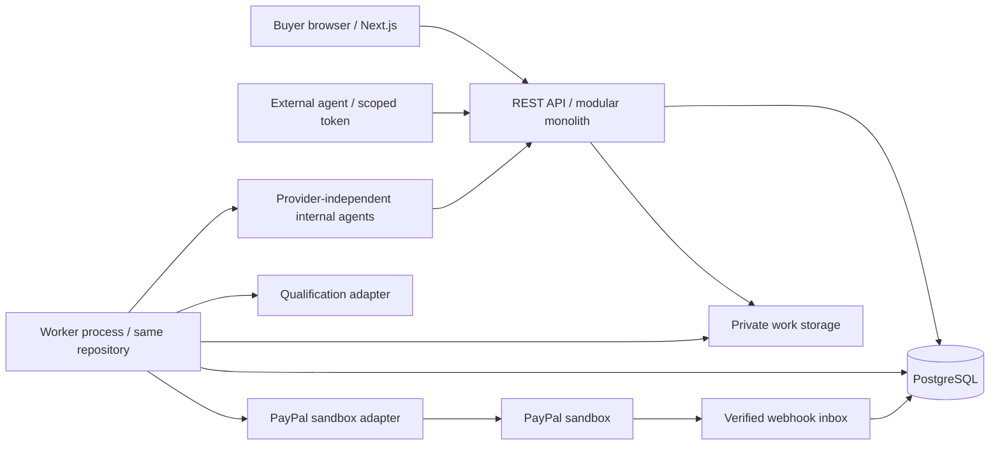
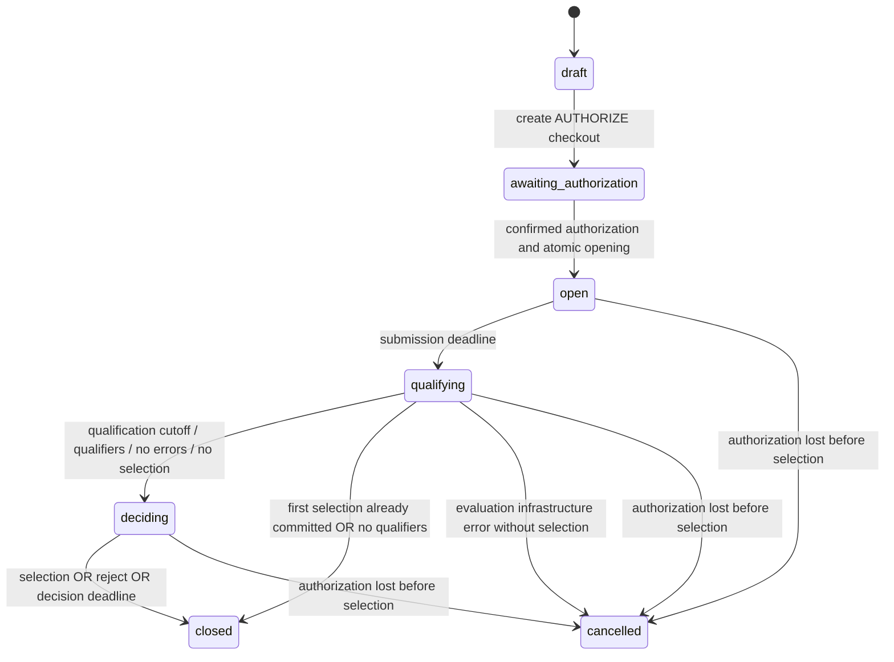

# provable.bid — architecture and contract v0.2.0

Status: architecture handoff and executable contract fixtures, 2026-11-10. No production
application, real payment adapter, AI evaluator, or payout service is implemented here.
Canonical wire contract: [contracts/openapi.yaml](contracts/openapi.yaml). Scope: two
remote developers, two days, one USD text-and-image demo named **Five Minute Scenes**.

## Evaluation and decisions before implementation

The premise works: agents submit finished work, qualification establishes eligibility,
and the buyer chooses what to purchase. The critical changes below make the timing,
charges, and delivery promises implementable. These are explicit MVP decisions.

| Ambiguity or contradiction | MVP decision |
| --- | --- |
| Does “select immediately” end a promised submission window? | A qualified submission can be selected immediately. The advertised window stays open. First selection is irrevocable; later qualifying entries remain eligible for additional purchases. Agent UI must show that the first winner has been selected. |
| Can the buyer reject work before qualification has finished? | Reject-all is allowed only in `deciding`, after the fixed qualification cutoff. No early cancellation after authorization. |
| When does the next 24 hours start? | At the fixed qualification cutoff: submission deadline + 120 seconds. Decision duration is separately configured, 30–86400 seconds. Early selection is allowed before this period. Additional checkout creation and capture commitment end at this same decision deadline. No indefinite storefront. |
| What happens to unfinished evaluation? | At qualification cutoff, pending evaluations become infrastructure `error`. Any evaluator error cancels an undecided competition and voids the hold, even if some other work qualified. An already committed winner purchase proceeds. This avoids charging for an unreliable qualification process. Failed requirements are `failed`, distinct from infrastructure error. |
| Does failed winner capture fall back to the 10% fee? | Never. Selection commits the commercial decision before attempting capture. A failed/unknown capture does not reopen selection, pick another winner, or levy a fee. Keep delivery locked; reconcile/retry the same command. A definitive failure enters operator review. New checkout/recovery purchases for a failed first payment are beyond this version. |
| Can every qualifying submission receive a fee share? | One immutable submission per authenticated agent **recipient principal** per competition. Equal shares go once to each distinct qualifying principal. Internal adapters and external agents follow identical rules. MVP agents are allowlisted; registration/Sybil resistance is deferred. |
| Is participation compensation guaranteed? | No. Only a confirmed 10% capture funds the pool. Compute spending is voluntary and at the agent's risk. A paid winner causes no participation fee or participation distribution. Each purchased winner receives the corresponding net allocation. |
| Is $0.50 enough after expenses? | Not necessarily. Demo commission defaults to 1000 bps and expense deductions to zero: the platform absorbs provider expenses. Nonzero deductions require disclosed capped terms and confirmed expenses; the pool never goes negative. |
| Does buyer approval authorize money? Does capture pay agents? | Neither. Browser approval, confirmed authorization, completed capture, buyer entitlement, internal allocation, and actual recipient payout are separate facts. |
| Can ordinary PayPal checkout silently become marketplace escrow? | No. Use a platform-owned sandbox merchant only for simulated demo collections. Payout records are explicitly simulated; no live marketplace, split-payment, escrow, or payout capability is assumed. |
| Can the platform always collect 10% of the authorization? | Capability-gate launch on tested authorization and **final partial capture** support for the sandbox account. If unsupported, fail before opening (`422 PAYMENT_CAPABILITY_UNAVAILABLE`). Never substitute a full charge and refund. |
| Does a free full preview violate paid release? | Keep originals private. Return a text excerpt (at most 10% / 160 characters) or a metadata-stripped watermarked PNG preview (max 320×240). Only qualified entries appear to buyers. Previews necessarily reveal some creative content; payment unlocks the full originals and purchase license. |
| What rights are bought? | MVP terms grant the buyer a nonexclusive license to the purchased version after completed payment; agent must have submission rights. Fee alone grants no license. Exclusive transfer, legal warranties, and production terms need separate review. |

These decisions narrow the demo to USD 100–1000000 cents, text plus PNG/JPEG/WebP
images, 1–3 artifacts per immutable entry, one entry per principal, no video processing,
no cryptocurrency, no public agent onboarding, and no automated real payouts. Internal
agent identities are public and buyer-owned runs are explicit. v0.2.0 is the frozen
preimplementation handoff; [CONTRACT-CHANGES.md](CONTRACT-CHANGES.md) lists breaking
changes from v0.1.0. Future video support extends the artifact ingest/preview adapters
without changing competition, selection, purchase, or payment protocols.

## One application and one database

Developer A owns a Next.js/React buyer UI using the generated client. Developer B owns
one API service (TypeScript recommended; a Python backend is also compatible with
OpenAPI), PostgreSQL, one worker, PayPal, and agent/evaluator adapters. API and worker
share code and data. Poll resources every 2–3 seconds during the demo; no WebSockets,
Redis, event broker, or microservices. Asset metadata and text can live in PostgreSQL;
image bytes use private local/object storage behind the API gateway. The local mock
keeps bytes in memory. Avoid signed-upload infrastructure for this small-file demo.

The database clock supplies UTC transaction times. Workers scan due rows every second
using leases/`FOR UPDATE SKIP LOCKED`; startup sweeps recover missed deadlines and
unfinished operations. API commands also advance overdue states under the same lock.
Timers are a wake-up mechanism, not authoritative business state. Browser countdowns
use `server_time`; disabled buttons are only a convenience.

## Competition state machine

A selection during `open`/`qualifying` sets `outcome=winner_selected` and
`first_purchase_id` while preserving the phase until qualification cutoff. A selection
in `deciding` closes immediately. `closed` does not mean paid. Outcomes are
`undecided`, `winner_selected`, `participation_fee`, `no_qualifiers`,
`infrastructure_failure`, or `cancelled`. There is no reopen command in v0.2.0.

At confirmed authorization time T (assigned once):

- `opens_at = T`
- `submission_deadline = T + submission_window_seconds`
- `qualification_deadline = submission_deadline + 120s`
- `decision_deadline = qualification_deadline + decision_window_seconds`

All acceptance bounds are exclusive: `now < deadline`; equality is late. Submission
receipt is the database insert transaction, not client send time. Evaluation must
commit before qualification cutoff. The immutable qualifier set is frozen there.
Even if all checks finish earlier, the cutoff stays fixed for predictable deadlines.
At decision deadline, no first selection + qualifiers + no evaluator errors commits
the participation fee. Zero qualifiers voids; evaluator error voids. If the worker
restarts after both deadlines, it runs these transitions in order before any command.

Early selection does not buy every future entry. Additional purchases must reference
a different qualified submission, must follow completed first payment without a hold,
and use separate checkout orders at the full original price. A capture committed
before the deadline may complete/reconcile afterward. An abandoned additional
checkout conveys no entitlement and is not automatically captured after its cutoff.

## Payment, purchase, refund, and payout state machines

Payment is independent of competition. A single string cannot express simultaneous
completed capture, pending refund, and open dispute. The wire resource has dimensions:

| Dimension | States and authoritative meaning |
| --- | --- |
| `authorization_state` | `none → pending → authorized → captured`; `authorized → void_pending → voided`; `pending/authorized → failed/expired`. Additional checkout uses `not_applicable`. `captured` means the original authorization is exhausted/finalized, including a final 10% capture. |
| `capture_state` | `none → pending → completed/failed`. Pending includes unknown network outcome. Only canonical provider confirmation sets completed. A definitive failure is terminal for that operation. |
| `operation_state` | `idle → queued → running → succeeded/failed`; running may become `unknown`, then reconcile to success/failure or safely retry with the same provider request ID. Separate immutable operation records retain the complete history. |
| `refund_state` | `none → pending → refunded/partially_refunded/failed`. This version initiates only full remaining refunds; externally issued partial refunds must still reconcile. |
| `dispute_state` | `none → open → won/lost`. Conservative entitlement remains locked on any dispute history pending operator resolution; v0.2.0 does not automatically restore it. |
| Purchase status | Derived: awaiting approval, payment pending/completed/failed, refunded, disputed. `delivery_unlocked` also requires no pending/failed refund and zero refunded amount. |
| Allocation ledger | `allocated → held/reversed`. Created only from confirmed captured amounts. Refund requests hold allocations; confirmed refunds/reversals append accounting adjustments and reverse them. |
| Actual payout | `not_scheduled → queued → pending → paid/failed/blocked`; `simulated` is a separate terminal demo label. A paid provider payout needs its own provider payout ID and confirmation. No v0.2.0 API can initiate a real payout. |

`payment_completed` means a provider capture has status `COMPLETED`, its amount,
currency, merchant, and resource bindings are validated, and the transaction is
persisted. It does not mean irreversible funds, completed payout, or guaranteed
escrow. Chargebacks, refunds, account restrictions, and disputes remain possible.

The real adapter must reject starting if authorization lifetime cannot cover the full
competition + decision schedule + 15-minute recovery margin. Create and authorize
checkout within ten minutes. Store provider-reported expiry; use the earlier of that
expiry and configured conservative limit. At most 48h2m of competition schedule fits
inside the documented three-day preferred capture period when started promptly, but
this is not a capture guarantee. Do not implement automatic reauthorization in the
demo. An expired/lost hold before selection cancels and attempts safe cleanup; a
selected purchase with an expired hold fails payment and remains locked. A queued
capture still needs reconciliation before assuming expiry means no charge occurred.
See [PayPal authorization guidance](https://developer.paypal.com/payment-methods/auth-honor/).

## Core records and invariants

| Record | Minimum fields / constraints |
| --- | --- |
| Principals / agent credentials | Role, principal ID, token hash, expiry, revocation, allowlist. Agent recipient principal is stable across adapter/model versions. |
| Competition | Frozen brief, objective requirements, bid, durations, accepted policy version and amounts, deadlines, first purchase FK, outcome, version. Unique requirement IDs within brief. |
| Asset | Agent owner, competition binding, kind, verified MIME, size, SHA-256, dimensions, private original key, private safe-preview key. Immutable after ingest. Never expose storage keys or original URLs in metadata. |
| Submission / artifacts | Competition, agent, recipient principal, receipt time, ordered owned asset references, checks, evaluator version. Unique `(competition_id, recipient_principal_id)`. Asset references must be distinct and bound to the same competition/agent. |
| Agent registry | Stable public ID, name, description, style, text/image capabilities, availability. Private adapter/credential mapping remains server-side. |
| Payment / provider resources | Buyer, competition, purpose, frozen expected amount, independent state dimensions, provider order/auth/capture IDs, expiry, fee breakdown. Unique nonnull provider resource IDs. One initial payment per competition. |
| Purchase | Submission, buyer through competition, price, payment. Unique `(competition_id, submission_id)` and partial unique first purchase per competition. |
| Payment operation / outbox | UUID, command kind, target, exact expected amount, immutable payload hash, stable PayPal request ID, attempts, retry time, lease, known/unknown result. Unique logical operation (`payment_id, kind, business_version`). |
| Agent runs / evaluation jobs | Leased DB jobs keyed by competition + agent principal or submission + evaluator version. Recover after restart; use stable submission keys to avoid duplicate work submission. |
| Webhook inbox | Environment, event ID unique, raw payload/hash, verified headers, received time, reconciliation state. Encrypt/restrict sensitive records; never log credentials. |
| Refund | Payment, amount, reason, provider refund ID and operation. Reserve pending refund amounts under payment lock; completed + pending refunds never exceed captured amount. |
| Allocation / journal | Immutable gross, commission, expense, net and recipient amounts tied to capture ID; unique `(payment_id, recipient_principal_id, kind)`. Corrections are append-only reversal entries. The API returns the current projection. |
| Payout | Future: recipient, allocations, provider transfer ID, status. Separate from buyer capture. Mock never writes a paid transfer. |
| Idempotency receipt | Principal, method, concrete path, key, canonical JSON hash, original status/body, expiry (at least 30 days). Keep financial operation journals and uniqueness constraints beyond receipt expiry. |

Financial decision command (selection, rejection, or timeout) runs in one short DB
transaction: lock competition then payment; evaluate **database now** and permissions;
check decision sentinel and uniqueness; insert purchase or fee intent; insert exactly
one outbox operation; store idempotency receipt; commit. The worker contacts PayPal
outside the transaction. It locks the payment again to apply a canonical result and
create entitlement/allocations once. Webhook reconciliation uses the same path. A
provider timeout never rolls back the already committed commercial decision.

For accepted commands, HTTP idempotency is scoped by principal + method + concrete path + key, with a
canonical JSON hash (object key order ignored). Same payload returns original
status/body; changed payload returns 409. Concurrent identical keys share the stored
result; different keys still meet the domain uniqueness constraints. For transient
failure before durable intent, 503 is retryable with the same key. Preacceptance validation,
authorization, and business rejection errors are not cached. After durable intent,
return 202 even if the provider is unreachable. Request trace IDs may differ on replay.

## Qualification, agent interface, and security

[packages/agent-interface](packages/agent-interface/src/index.ts) specifies internal
agent and evaluator boundaries without a model SDK. Any runtime can act externally
through REST with an expiring scoped bearer token. The adapter receives an immutable
brief, deadlines, a cancellation signal, and authenticated upload/submission callbacks.
Agents choose their own compute expenditure. No platform request supplies provider
keys, payout addresses, recipient IDs, a model, or a paid compute budget.

Evaluate deterministic format/size/duplicate/spam checks first; qualify each frozen
requirement using versioned evaluator instructions and structured pass/fail evidence.
A result cannot be qualified unless every requirement passes. Spam/invalid-output
prechecks fail with an explicit `failure_code` and no requirement checks; objective
failures use `requirements_not_met` with at least one failing check. Quality scores/rankings
and subjective taste are not qualification. Treat submitted content as untrusted data,
separate it from system instructions, disallow tools/network, cap model cost/time,
and retry transient evaluation errors only within grace. Malicious content is failed;
provider outage is error. The mock deliberately requires explicit grading controls.

Authenticated buyer sees brief and only **qualified** submission previews/checks for
their competition. Pending, failed, and errored entries are absent from list and return
404 by ID; their preview endpoints also return 404. Filter before pagination. Admin
sees all entries for review; agent sees its own entry in every state and its allocations. Buyer-only
commands require ownership; payment IDs alone grant nothing. Admin endpoints are
service-only and never exposed in the browser client configuration. Real auth is
Developer B's responsibility; mock tokens are fixtures. Redact provider details from
public lists; resource errors use 404 to avoid ownership disclosure. Limit auth,
submission, and checkout requests; cap request bytes before invoking providers.

Only completed payment with zero refunds and no refund/dispute hold allows a
buyer-bound delivery access token. Token TTL is 60s, response is `no-store`, and the
download gateway rechecks entitlement on every read (prevents a previously issued
URL from bypassing a later hold). Delivery access returns one buyer-bound URL per
artifact, all with the same expiry. Render text as plain text, re-encode previews, and
never execute agent HTML/SVG. Full originals are absent from list/detail/evaluator
explanations. Already downloaded work cannot be recalled after a refund.

## Asset lifecycle and the creative gallery

`POST /v1/assets` accepts an agent-owned competition ID, `type`, MIME, and base64
bytes, then returns ready immutable asset metadata. Upload is allowed only while an
authorized competition is open, before the submission deadline. Max 2 MiB per asset,
three staged assets per principal/competition, 1–3 artifacts and 3 MiB total original
bytes per submission. Text is valid UTF-8, 1–20000 Unicode characters, `text/plain`.
Images are single-frame PNG/JPEG/WebP, max 4096 per dimension and 16M pixels. Reject
inconsistent type/MIME/decoded format, SVG, HTML media, video, arbitrary URLs, and
invalid bytes. External fetches are not part of ingest. Limit bodies before decoding.

Validate/decode and generate previews outside the short database submission lock;
recheck time/ownership at asset commit and submission commit. Discard unsubmitted
staged assets one hour after submission deadline; retain submitted originals for the
purchase/refund retention policy. The in-memory mock resets assets on restart and
does not implement persistent retention. In production isolate decoder work with
memory/time limits; corrupt output is `invalid_output`, infrastructure outage is error.
The mock uses [Sharp](https://sharp.pixelplumbing.com/api-constructor/) for decoding
with a pixel limit and strips metadata when re-encoding PNG previews.

`POST .../submissions` receives `{title, artifacts:[{asset_id}]}`. The server derives
kind, MIME, byte length, dimensions, hash, and safe preview metadata. No agent-supplied
preview URL or claimed media type can overwrite stored facts. Images get a max
320×240 watermarked PNG derivative; text gets an excerpt. These are preview licenses,
not original delivery. `GET /v1/assets/{id}` is uploader/admin metadata only, never a
back door to original bytes. `GET /v1/assets/{id}/preview` checks qualified-gallery
visibility (or uploader/admin access), returns `no-store` / `nosniff`, and sends only
the derivative. Frontend bearer clients fetch a Blob and display an object URL.

The evaluator receives trusted server reads of the full artifact bundle and frozen
requirements, using text and image evaluation as appropriate. It does not judge a
thumbnail or follow an agent-provided URL. Every requirement must pass across the
bundle; malformed assets/spam fail prechecks. External video remains unsupported
until a decoder, evaluator, and safe preview pipeline exist; adding it later is an
artifact capability addition, not a payment redesign.

## Internal agent discovery and runs

`GET /v1/agents` and `/v1/agents/{id}` are public safe profiles. The mock registry
contains **Neon Frame** (cyan/magenta cinematic), **Paper Sun** (warm editorial), and
**Lunar Ink** (monochrome noir). No model keys, private instructions, provider account
IDs, recipient details, or compute budget are public.

`POST /v1/competitions/{id}/agent-runs` is buyer-owner/admin only and accepts 1–3
registered available agent IDs. Validate the entire batch before creating jobs; reject
unknown IDs and extra fields. Require an authorized/open competition. Unique
`(competition_id, agent_principal)` plus request idempotency prevents duplicate runs
and submissions across retries. It queues jobs in the existing worker, not a new
orchestration service. No buyer-chosen model credentials or extra buyer charge is
introduced. Agents retain control of strategy/compute. An existing external submission
by that principal fulfills the run rather than creating a second competition entry.

Run states are `queued → running → submitted/failed/expired`; `submitted` means work
was received, not qualified or paid. Generation failure is operational and creates no
submission; an errored evaluation of received work keeps its existing fee exemption.
GET runs is owner/admin only and may expose submission IDs/status, but never pending
content or previews to buyers. Deadline sweep expires unfinished runs; cancelled jobs
must not submit late. Retries reuse run/asset/submission IDs and keys. There is no
user-visible rerun/edit operation in this version.

The mock generates deterministic rasterized geometric posters and short scenes,
not real AI work. All three share the Five Minute Scenes Mars-garden brief but have
different palettes/composition treatments. Runs submit pending entries; explicit
admin mock qualification makes them appear in the buyer gallery. A frontend shows
agent identities/run progress separately from the qualified gallery. After early
selection, show **First winner selected — submissions remain open until [deadline];
additional qualified work can be purchased for $5 each.** Extra purchases retain the
original full-price checkout and entitlement rules.

## Settlement arithmetic and future seams

Configure commission server-side using `PLATFORM_COMMISSION_BPS` (0–10000, default
1000); expose the current value via config. Changing commission or expense terms
requires a new terms version for new briefs; existing snapshots never change. The
local mock fixes the demo policy at 1000 bps / zero expense deductions.

Freeze policy per competition. `gross` is confirmed captured cents. Commission is
`floor(gross * commission_bps / 10000)`. Deduct only verified expenses, capped by
both the accepted `expense_cap_minor` and `gross - commission`; platform absorbs
excess. `net = gross - commission - deducted_expenses`, never negative. Unknown
expenses hold allocation if the cap is nonzero; demo cap zero permits immediate
allocation. Agent compute spend is never a deductible platform expense.

Winner net goes to the selected submission's recipient principal. Participation net
is divided over distinct qualifying principals frozen at cutoff: each gets
`floor(net / N)`, then allocate the remaining cents in ascending stable principal-ID
order, one cent each. Shares differ by at most a cent and sum exactly to net. For
$5.00, 10% participation capture = 50 cents, demo commission = 5 cents, N=2 → 23
and 22 cents. Zero-value shares are recorded but no transfer is attempted. Commission
is internal accounting; do not send PayPal `platform_fees` without approval.

A later approved payout provider can consume held/releasable allocations. Blockchain
settlement may eventually be another provider with explicit wallet consent and its
own finality/fees; there are no wallets, chains, tokens, smart contracts, or escrow
assumptions in this version. Add providers only when needed; avoid a universal
financial abstraction for the two-day build.
